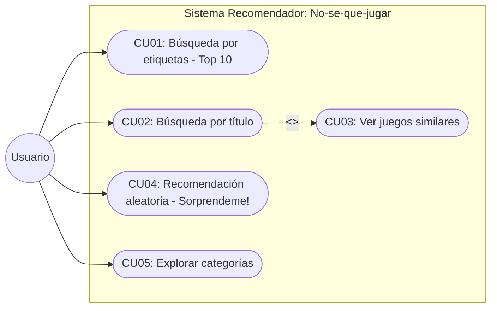

# Casos de Uso 

## 1. Diagrama General de Casos de Uso

## Especificación de Casos de Uso

### CU01: Búsqueda por etiquetas (Ranking Top 10)
* **Actor:** Usuario.
* **Precondición:** El catálogo de videojuegos (`datos/juegos.csv`) está cargado en memoria.
* **Flujo principal:**
  1. El usuario selecciona la opción `1) Búsqueda por etiquetas` en el menú principal.
  2. El sistema solicita ingresar una o más etiquetas (*tags*) separadas por coma.
  3. El usuario ingresa las etiquetas deseadas (ej. `Action, RPG`).
  4. El sistema calcula un puntaje para cada juego que coincida (`rating + 10 * cantidad_de_coincidencias`) y los inserta en un **Heap** máximo.
  5. El sistema extrae y muestra el **Top 10** de videojuegos recomendados ordenados por mayor puntaje.
* **Flujo alternativo:** Si ningún videojuego del catálogo coincide con las etiquetas ingresadas (el Heap queda vacío), el sistema informa *"No se encontraron juegos con esas etiquetas."* y vuelve al menú.

---

### CU02: Búsqueda por título
* **Actor:** Usuario.
* **Precondición:** El árbol **AVL** está inicializado e indexado por título en minúsculas.
* **Flujo principal:**
  1. El usuario selecciona la opción `2) Busqueda por titulo` en el menú principal.
  2. El sistema solicita ingresar el título exacto del videojuego.
  3. El usuario escribe el nombre del juego.
  4. El sistema realiza la búsqueda en el **AVL** y muestra los datos del juego encontrado junto con la pregunta *"¿Ver juegos similares? (s/n)"*.
* **Flujo alternativo:** Si el título no existe en el árbol, el sistema muestra *"No se encontró '[título]'."* y retorna al menú principal.

---

### CU03: Ver juegos similares (desde búsqueda por título)
* **Actor:** Usuario.
* **Precondición:** El usuario buscó un juego existente en el CU02 y el sistema le ofrece ver similares.
* **Flujo principal:**
  1. Ante la consulta *"¿Ver juegos similares? (s/n)"*, el usuario ingresa `s`.
  2. El sistema compara los tags del juego base contra el resto del catálogo y selecciona hasta 15 candidatos con etiquetas en común.
  3. El sistema construye un **Grafo** ponderado (con peso inversamente proporcional a la cantidad de tags compartidos: `1 / comunes`) y ejecuta un recorrido **BFS** desde el juego base.
  4. El sistema muestra hasta 5 videojuegos similares recomendados.
* **Flujo alternativo:** Si el usuario responde `n`, se omite la construcción del grafo y vuelve al menú; si ningún otro juego comparte tags con el título buscado, informa *"No se encontraron juegos similares."*

---

### CU04: Recomendación aleatoria ("¡Sorprendeme!")
* **Actor:** Usuario.
* **Precondición:** La lista de videojuegos contiene al menos un elemento cargado.
* **Flujo principal:**
  1. El usuario selecciona la opción `3) Sorprendeme!`

---

### CU05: Explorar categorías
* **Actor:** Usuario.
* **Precondición:** El **Árbol General** de categorías está inicializado con la jerarquía de géneros y subgéneros.
* **Flujo principal:**
  1. El usuario selecciona la opción `4) Explorar categorías` en el menú principal.
  2. El sistema recorre los nodos hijos de la raíz (`Action`, `Adventure`, `RPG`, `Strategy`) en el **Árbol General**.
  3. El sistema muestra cada categoría principal junto con sus subcategorías asociadas (ej. `RPG: JRPG, Open World`).
* **Flujo alternativo:** No aplica flujo alternativo de entrada, ya que es una visualización directa de la jerarquía predefinida antes de volver al menú con Enter.