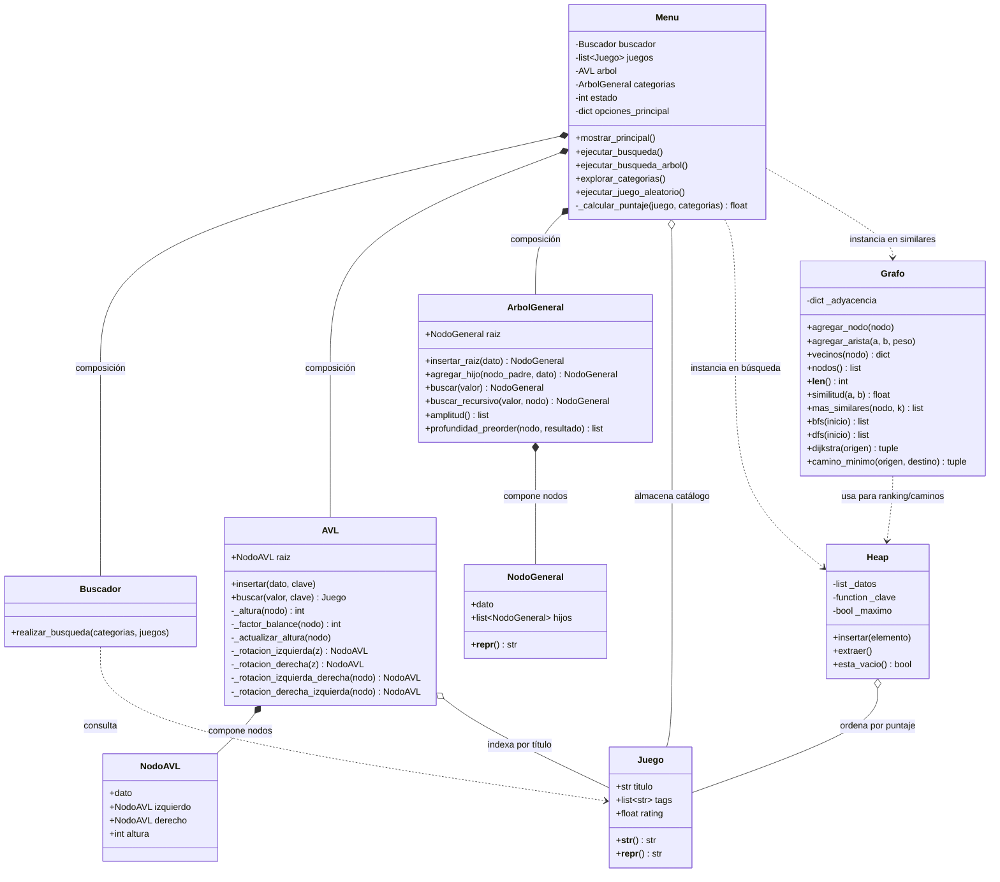

# Diagrama de Clases

## 1. Diagrama UML de Clases

---

## 2. Descripción de Clases y Relaciones

### Clases de Dominio e Interfaz
* **`Juego` (`modelos/juego.py`):** Entidad principal que modela cada videojuego del catálogo con su `titulo`, lista unificada de `tags` (géneros + etiquetas) y `rating` numérico.
* **`Menu` (`ui/terminal.py`):** Controlador principal de la aplicación. Carga el catálogo desde `datos/juegos.csv`, inicializa las estructuras permanentes (`AVL` y `ArbolGeneral`) y gestiona la navegación y consultas por consola.
* **`Buscador` (`ui/terminal.py`):** Clase auxiliar de filtrado por etiquetas sobre la lista de juegos.

### Clases de Estructuras de Datos (`estructuras/`)
* **`AVL` y `NodoAVL` (`estructuras/avl.py`):** Árbol binario de búsqueda autobalanceado mediante rotaciones simples y dobles. Indexa los objetos `Juego` por su título en minúsculas para garantizar búsquedas en $O(\log n)$.
* **`ArbolGeneral` y `NodoGeneral` (`estructuras/arbol_general.py`):** Árbol $n$-ario que modela la jerarquía de categorías y subcategorías de videojuegos (`Action`, `Adventure`, `RPG`, `Strategy`).
* **`Heap` (`estructuras/heap.py`):** Cola de prioridad configurable como Min-Heap o Max-Heap (`maximo=True`). Se instancia dinámicamente en `Menu.ejecutar_busqueda()` para obtener el Top 10 por puntaje, y también es utilizada internamente por `Grafo`.
* **`Grafo` (`estructuras/grafo.py`):** Grafo no dirigido y ponderado implementado con diccionario de adyacencia (`_adyacencia`). Se construye bajo demanda en `Menu.ejecutar_busqueda_arbol()` para vincular un juego base con candidatos similares y recorrerlos mediante **BFS** (además de contar con implementaciones de `dfs`, `dijkstra` y `camino_minimo`).

### Tipos de Relaciones UML
* **Composición (`*--`):** `AVL` y `ArbolGeneral` crean y gestionan el ciclo de vida de sus propios nodos (`NodoAVL` y `NodoGeneral`); a su vez, `Menu` compone `AVL`, `ArbolGeneral` y `Buscador`.
* **Agregación (`o--`):** `Menu`, `AVL` y `Heap` almacenan referencias a objetos `Juego` sin destruir las entidades del catálogo al liberar una estructura temporal.
* **Dependencia (`..>`):** `Menu` instancia `Heap` y `Grafo` únicamente durante la ejecución de las consultas específicas, y `Grafo` importa `Heap` para operaciones auxiliares de ordenamiento/prioridad.