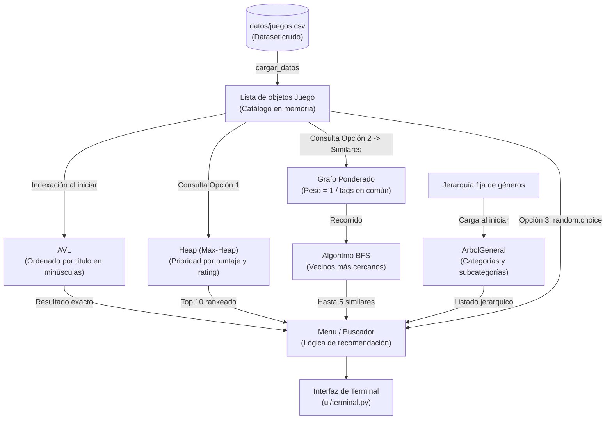

# Diagrama de Conexión entre Estructuras 

## 1. Flujo de Datos y Estructuras en Memoria

---

## 2. Explicación de la Arquitectura de Datos

1. **Carga inicial (`datos/juegos.csv` → `list[Juego]`):** Al iniciar la aplicación (`Menu.__init__`), se lee el archivo CSV y se instancian los objetos `Juego` con título, lista unificada de tags y rating.
2. **Estructuras permanentes (en memoria durante toda la ejecución):**
   * **`AVL`:** Se pobla una única vez al arrancar indexando todos los objetos `Juego` por su título en minúsculas para resolver búsquedas exactas en $O(\log n)$.
   * **`ArbolGeneral`:** Se construye al inicio con la taxonomía de géneros principales (`Action`, `Adventure`, `RPG`, `Strategy`) y sus respectivas subcategorías.
3. **Estructuras dinámicas (creadas bajo demanda por consulta):**
   * **`Heap` (Max-Heap):** En la *Opción 1 (Búsqueda por etiquetas)*, se filtran los juegos coincidentes, se les asigna un puntaje (`rating + 10 * coincidencias`) y se insertan en un `Heap` máximo para extraer únicamente el **Top 10** sin ordenar todo el dataset.
   * **`Grafo` + `BFS`:** En la *Opción 2 (Búsqueda por título)*, si el usuario solicita ver juegos similares, se arma un `Grafo` con hasta 15 candidatos que compartan etiquetas (ponderando aristas por similitud inversa) y se recorre con **BFS** para sugerir los 5 más cercanos.