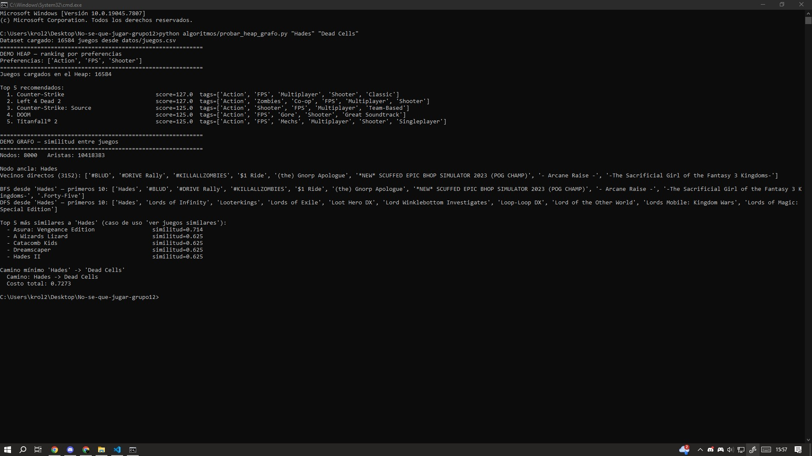
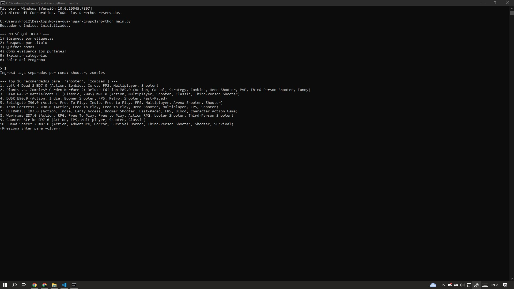

# TP6: Análisis e Integración de Heap y Grafos

## 1. Introducción
Para esta etapa, se solicitó la incorporación de las estructuras de datos **Heap** y **Grafo**.

Siguiendo la consigna, la integración funcional del Grafo no era excluyente. Por lo tanto, implementamos e integramos el [Heap](estructuras/heap.py) al programa principal, y desarrollamos el [Grafo](estructuras/grafo.py) de forma aislada, el cual fue [probado](algoritmos/probar_heap_grafo.py) con datos reales para garantizar su funcionamiento.

## 2. Implementación del Heap
Se implementó una clase `Heap` que funciona como Max-Heap por defecto. Se utilizó para rankear juegos según un "score de similitud" con las preferencias del usuario (ej: Action, FPS, Shooter), devolviendo el Top 10 de recomendaciones.

**Integración en el menú principal:**
El Heap fue integrado en la **Opción 1 (Búsqueda por etiquetas)** de `terminal.py`. Anteriormente, la búsqueda imprimía todos los resultados de forma lineal y desordenada. Ahora, los juegos que coinciden se insertan en el Heap, el cual calcula un score de relevancia (Rating + 10 puntos por cada tag coincidente) y devuelve un "Top 10" ordenado, eliminando duplicados y mejorando la experiencia de usuario.

## 3. Implementación del Grafo y Decisión de Arquitectura
Se implementó un `Grafo` no dirigido con lista de adyacencia. Los nodos son los juegos y las aristas representan su similitud.

La clase `Grafo` queda declarada, probada y lista, pero aislada del flujo principal. El análisis que fundamenta esta decisión se detalla en la Sección 5.

---

## 4. Plan de Integración Futura
*   **Grafo en la Opción 2 (Búsqueda por título):** Añadir un botón de "Ver juegos similares" tras encontrar un juego por su título, usando los vecinos del Grafo (BFS).
*   **Opción 4 (Metodología y Juego Aleatorio):** Se planea mover el texto explicativo actual al `README.md` y reemplazar esta opción en el menú por una función de "Juego Aleatorio" (¡Sorpréndeme!), que devuelva un título al azar del dataset para resolver el problema principal de la aplicación.
---

## 5. Análisis de Rendimiento y Escalabilidad

Durante las pruebas de validación nos enfrentamos a un límite de rendimiento.

**El desafío:** Al intentar ampliar el subconjunto de pruebas a 8.000 juegos para obtener resultados de similitud más precisos, el tiempo de ejecución del script se incrementó significativamente. Esto evidenció el impacto de la complejidad temporal **O(V²)** del algoritmo de similitud, que requiere comparar cada juego contra el resto de los nodos. Concluimos que intentar correrlo con el volumen real de juegos que maneja el programa no significaría en absoluto una solución al problema que trata de enfrentar nuestro proyecto.

**La decisión de arquitectura:** Esta prueba empírica validó nuestra decisión de no integrar el Grafo de forma directa y masiva en el flujo principal (`terminal.py`). Confirmamos que hacerlo degradaría severamente la experiencia del usuario. Por lo tanto, se optó por mantener la clase aislada (como lo permite la consigna) y documentar este cuello de botella como el principal motivo por el cual se requiere una optimización previa antes de su integración final.

---

## 6. Evidencia de Funcionamiento 

En la captura se puede observar el funcionamiento de ambas estructuras integradas en el script de prueba:

**Heap (Parte superior):** Se observa cómo el Heap rankea eficientemente los juegos según las preferencias (Action, FPS, Shooter), devolviendo el Top 5 de recomendaciones (Titanfall 2, Left 4 Dead 2, etc.) sin necesidad de ordenar los 16.584 juegos.

**Grafo (Parte inferior):** Se observa el problema del rendimiento mencionado en la sección 5 (se generaron más de 10 millones de aristas al procesar 8000 nodos). A pesar de ello, el algoritmo de Dijkstra encuentra el camino mínimo directo entre "Hades" y "Dead Cells". Además, el Top 5 de similitudes devuelve juegos coherentes como "Hades II" y "Dreamscaper", validando la efectividad del índice de Jaccard.

**Observación sobre la búsqueda por coincidencia parcial:**

En esta captura se puede observar la incorporación del Heap al programa ya funcionando en la búsqueda del menú 1.

Durante las pruebas de integración del Heap en la Opción 1, notamos que al buscar "shooter, zombies", aparecían juegos en el Top 10 a pesar de no tener la etiqueta "zombies". Por ejemplo, Warframe tiene los tags "Looter Shooter" y "Third-Person Shooter". Al contener la palabra "shooter" en ambos, el algoritmo de puntaje le asigna 20 puntos extra (10 por cada tag) y escala posiciones.

**Conclusión:** Es un comportamiento esperado del algoritmo actual. Se podría implementar una búsqueda por coincidencia exacta, pero consideramos que resta comodidad el tener que especificar demasiado las tags.
